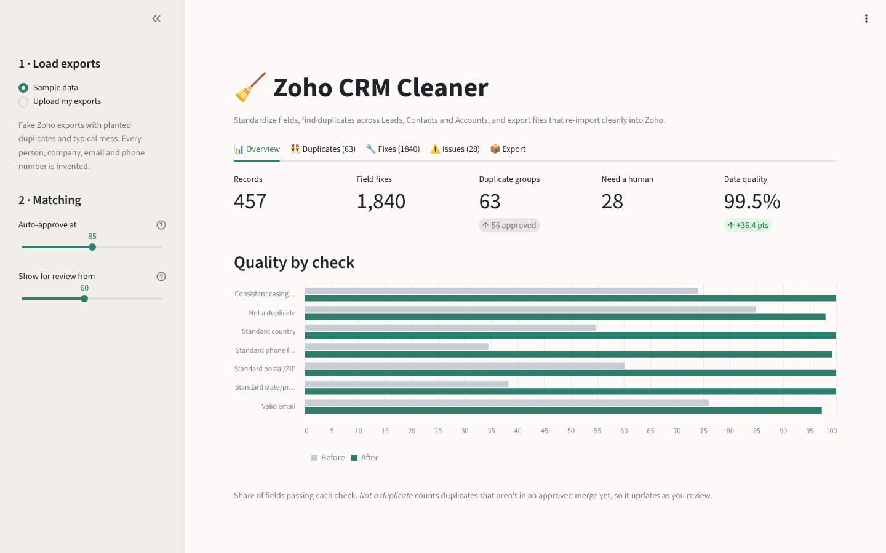
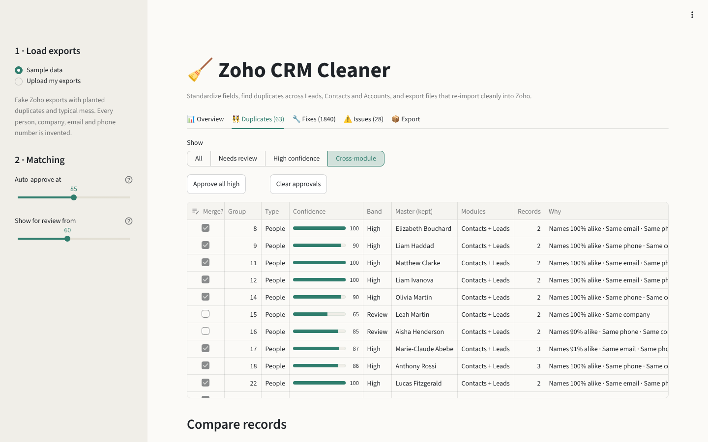
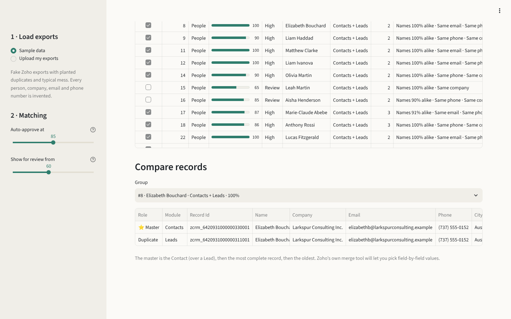

# 🧹 Zoho CRM Cleaner

**Clean, standardize and deduplicate Zoho CRM exports, then re-import them without breaking anything.**

Every CRM collects mess: `ONTARIO`, `Ont.` and `on` in the same field, phone numbers in eight
formats, and the same person living as a Lead *and* a Contact because a web form came in after
they'd already become a customer. Zoho's built-in deduplication works one module at a time and
matches on exact values, so most of this slips through.

This tool takes your Leads, Contacts and Accounts exports and gives you back:

- **Cleaned files** that keep every `Record Id`, so re-importing *updates* your existing records
  instead of creating a fresh batch of duplicates
- **A reviewable merge plan** of duplicates found within and *across* modules, each with a
  confidence score and a plain-English reason
- **A change log** of every edit, before and after
- **A list of issues** that need a human, like malformed emails or people you can't reach



## Try it

```bash
git clone https://github.com/gravewar/crm-cleaner.git
cd crm-cleaner
pip install -r requirements.txt
streamlit run app.py
```

It opens with sample data loaded, so you can click around straight away. To use your own data,
export from Zoho (**Setup → Data Administration → Export**) and upload the CSV or Excel files.

## What it fixes

| Field | Before | After |
|---|---|---|
| Phone | `416.555.0123 x12`, `+14165550123`, `1-416-555-0123` | `(416) 555-0123 ext. 12` |
| State/Province | `Ont.`, `ontario`, `ON `, `Québec`, `PQ` | `ON`, `QC` |
| Postal / ZIP | `m5v2t6`, `M5V-2T6`, `2108` (Excel dropped the zero) | `M5V 2T6`, `02108` |
| Company | `NORTHWIND ANALYTICS, INC`, `northwind analytics incorporated` | `Northwind Analytics Inc.` |
| Name | `SARAH`, `o'brien`, `mcneil`, `  Sarah  ` | `Sarah`, `O'Brien`, `McNeil` |
| Email | ` Jane.Doe@Example.COM ` | `jane.doe@example.com` |
| Country | `USA`, `U.S.`, `United States of America` | `United States` |

The tool leaves alone anything it isn't sure about. `DeAndre` stays `DeAndre`, international
numbers aren't reformatted, and a 4-digit ZIP only gets its zero back when the record is known to
be in the US. Anything it can't fix goes to the issues list instead of being guessed at.

## How duplicate detection works



**1. Blocking.** Comparing every record to every other record is O(n²), which gets slow fast.
Each record gets a few cheap keys instead (its email, its phone, the start and end of its surname,
its company plus first name). Only records that share a key get compared. A typo in one field
doesn't hide a duplicate, because another key will still catch it.

**2. Explainable scoring.** Each candidate pair gets a 0–100 score built from evidence you can read:

| Signal | Effect |
|---|---|
| Name similarity (fuzzy, nickname-aware, so Bob = Robert) | up to +50 |
| Same email | +40 |
| Same phone | +25 |
| Same company | +15 |
| Clearly different company | −15 |
| Different work emails at the same domain | −20 |
| Different surname, or clearly different first name | capped at 55 |

The caps and penalties exist because the hard part of deduplication is **not** merging the wrong
people. Three colleagues listing the same switchboard number aren't one person. Neither are
Sam and Leah Gagnon at the same office, or two Sarah Chens at different companies. A shared
`info@` inbox is ignored as evidence.

**3. Clustering and a master record.** Matching pairs are grouped with union-find. The suggested
master is the Contact rather than the Lead, then the most complete record, then the oldest.

**4. Human review.** Groups above 85 start out approved. Groups from 60 to 85 are shown for
review. Both thresholds can be adjusted in the sidebar.



## Built around how Zoho actually works

- **Record Ids are never touched.** Import the cleaned CSVs with *Update existing records*,
  matching on Record Id, and Zoho updates in place.
- **Merges are a plan, not an action.** Merging rows in a spreadsheet would orphan the notes,
  calls, emails and deals attached to the duplicate. The merge plan tells you what to merge, and
  Zoho's own merge tool moves those related records onto the master.
- **Leads that are already Contacts** are flagged with a different action: convert or delete,
  not merge.
- **Contacts are lined up to their Account.** `RESEARCH LIGHTHOUSE` on a Contact becomes
  `Research Lighthouse Inc.` to match the Account record, so lookups and lead conversion link
  to the right company.

## Accuracy

`zcleaner evaluate` scores the matcher against the answer key bundled with the sample data,
using pairwise precision and recall:

| Clusters used | Precision | Recall |
|---|---|---|
| High confidence only (auto-approved) | 100% | 85% |
| High + Review | 100% | 100% |

Across five differently-seeded datasets, High + Review found every planted duplicate with no
false merges, and the auto-approved groups alone caught 85–99% of them. **One caveat:** this is synthetic data, built with realistic but known kinds of
mess, so real-world data will be harder. That's why nothing is merged without a person approving it.

## Command line

```bash
pip install -e .

zcleaner generate --out sample_data            # fresh fake exports + answer key
zcleaner clean --leads Leads.csv --contacts Contacts.csv --accounts Accounts.csv --out cleaned/
zcleaner evaluate --data sample_data           # precision / recall
```

The CLI only approves high-confidence groups unless you pass `--approve-review`.

## Project layout

```
app.py                  Streamlit review UI
zcleaner/
  schema.py             maps each org's Zoho column labels to roles
  normalize.py          field normalizers (phone, region, postal, company, name, email)
  validate.py           issues that need a human
  match.py              blocking, pair scoring, union-find clustering
  pipeline.py           runs the full cleanup; merge plan and quality score
  report.py             cleaned files, logs, summary, zip
  synth.py              realistic fake Zoho exports with an answer key
  evaluate.py           precision / recall
tests/                  45 tests, run in CI on Python 3.10–3.13
```

## About the sample data

Every record in `sample_data/` is invented. Companies are made-up word pairs, emails use the
reserved `.example` domain, and phone numbers use the 555-01XX range set aside for fiction. The
generator plants duplicates the way they really happen: converted leads left behind, nicknames,
typos, a personal email on the second copy, Excel stripping ZIP-code zeros. It also plants traps
the matcher must *not* merge, such as same-name strangers and colleagues sharing a switchboard.

Please don't commit real CRM exports. The `.gitignore` blocks the usual places they'd land.

## Roadmap

- [ ] Direct Zoho CRM API connection (OAuth), so merges can run straight from the approved plan
- [ ] Saved cleanup "recipes" to re-run on each new export
- [ ] Custom picklist mapping, such as clustering messy Lead Source values
- [ ] Field-by-field survivor rules ("keep the newest phone, the longest address")

## License

MIT © Danielle Burns
